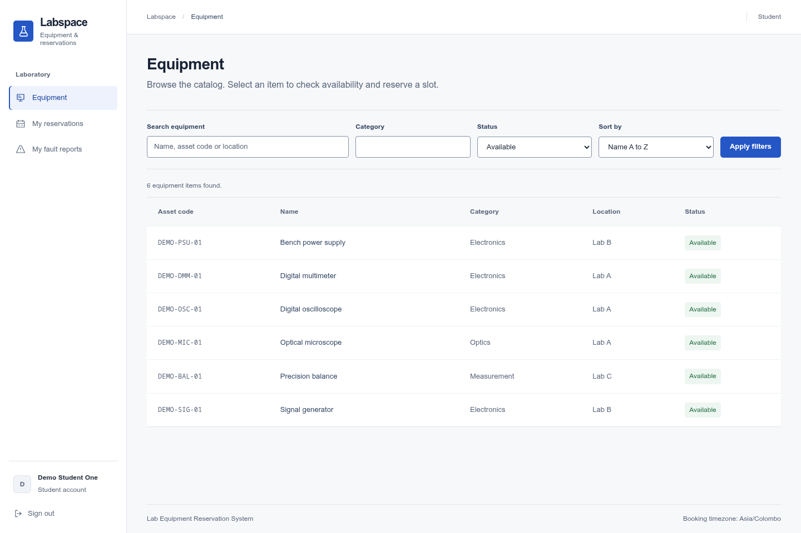
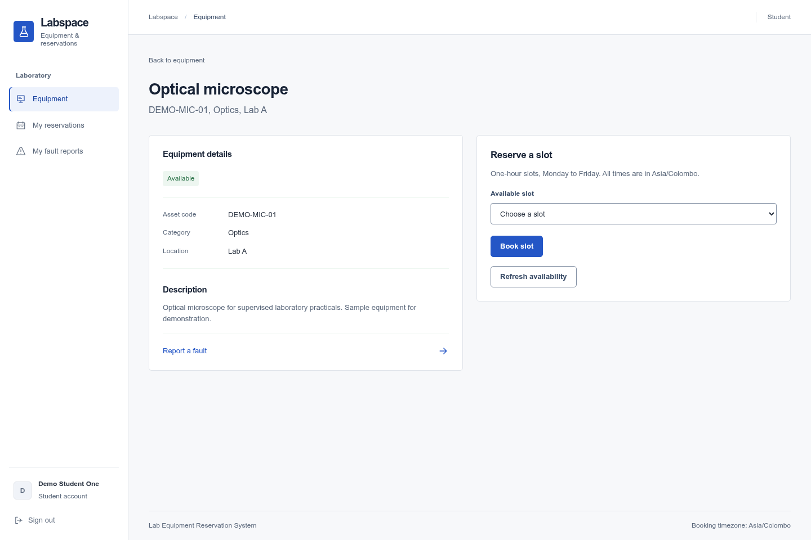
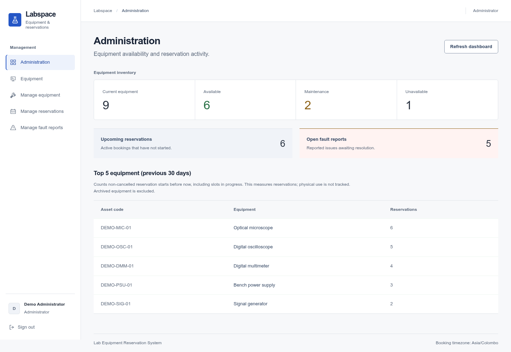
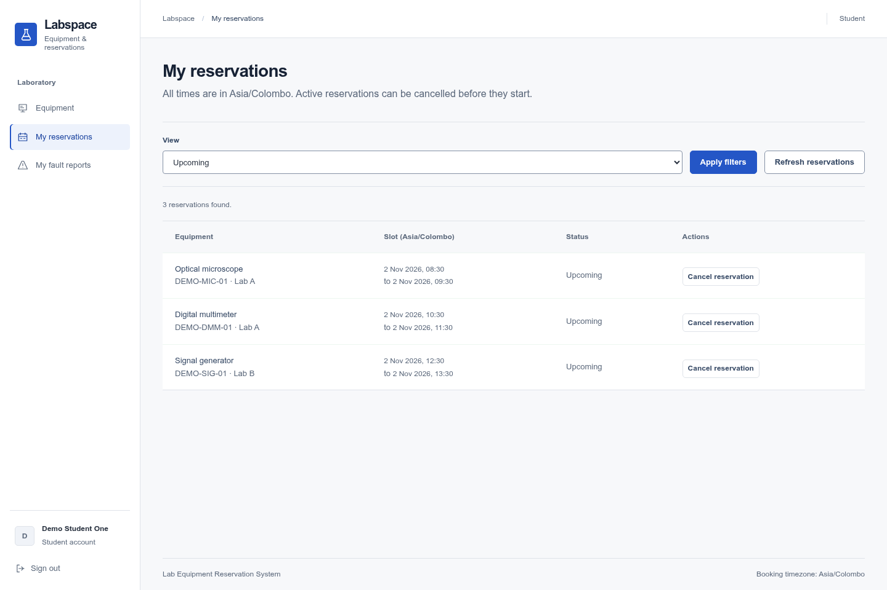
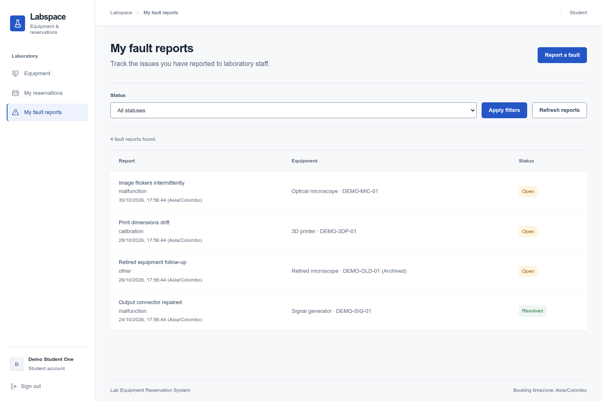

# Lab Equipment Reservation System

A full-stack application for managing laboratory equipment, student reservations,
and fault reports. Built with React, Express, and MongoDB, it provides separate
student and administrator workflows, conflict-safe bookings, and an audit trail
for equipment and reservation changes.



## Features

- **Equipment catalog:** Search, filter, sort, and browse equipment with current
  availability, asset details, and operational status.
- **Reservations:** Book available time slots, review upcoming and historical
  reservations, and cancel future bookings. MongoDB transactions and a unique
  active-slot index prevent double bookings.
- **Fault reporting:** Students submit and track equipment issues; administrators
  review reports and record resolution notes.
- **Equipment administration:** Create and edit assets, change operational status,
  and archive equipment while preserving its history. Maintenance, unavailability,
  and archiving cancel future reservations automatically.
- **Admin dashboard:** View equipment totals, upcoming reservations, open faults,
  and the most-booked equipment over the previous 30 days.
- **Authentication and access control:** Student registration, administrator
  provisioning, Argon2id password hashing, MongoDB-backed sessions, CSRF protection,
  and role-based API authorization.

### Booking rules

Reservations last one hour, Monday through Friday, with start times from **08:30
through 15:30 in Asia/Colombo**. Slots must start in the future and fall within
14 rolling days. Students can cancel only their own future reservations;
administrators can manage all future reservations.

Fault reports do not automatically change equipment status. Administrators manage
availability separately, and returning equipment to service does not restore
cancelled bookings.

## Screenshots

| Equipment booking                                  | Administrator dashboard                              |
| -------------------------------------------------- | ---------------------------------------------------- |
|  |    |
| Reservation management                             | Fault reporting                                      |
|  |  |

## Technology

| Layer      | Tools                                                           |
| ---------- | --------------------------------------------------------------- |
| Frontend   | React 19, React Router, Vite, CSS, GSAP                         |
| Backend    | Node.js 24, Express 5, Mongoose, Zod                            |
| Database   | MongoDB 8 replica set, including session storage                |
| Security   | Argon2id, Express Session, Helmet, CSRF protection, rate limits |
| Testing    | Vitest, React Testing Library, Supertest, Playwright            |
| Tooling    | Bun workspaces, ESLint, Prettier, GitHub Actions                |
| Deployment | Render web service with MongoDB Atlas                           |

## Getting started

### Prerequisites

- **Node.js 24.21.0** or a later Node 24 patch; see [.node-version](.node-version).
- **Bun 1.4.3**; see [.bun-version](.bun-version).
- **Docker with Docker Compose** for the local MongoDB replica set.

Bun manages dependencies and package scripts. The backend runs on Node.js.
Run the commands below from the repository root.

### 1. Install and configure

```sh
bun install --frozen-lockfile
cp .env.example .env
```

Generate a session secret, then paste the output into `SESSION_SECRET` in `.env`:

```sh
bun -e "console.log(require('node:crypto').randomBytes(32).toString('hex'))"
```

### 2. Start MongoDB

```sh
docker compose up -d --wait mongo
bun run db:replset-init
bun run db:check
```

A replica set is required for transactions. The initialization command is safe to
repeat; the check command verifies that a transaction can commit. MongoDB is
available on `localhost:27017`, bound to the loopback interface, with persistent
data in the `mongo-data` Docker volume. The Compose file runs only the database;
run the application on your host.

### 3. Start the application

Run the backend and frontend in separate terminals:

```sh
bun run dev:server
```

```sh
bun run dev:client
```

- **Application:** <http://localhost:5173>
- **API health:** <http://localhost:3000/api/v1/health>

Vite forwards `/api` requests to Express on port `3000`. Register at `/register`
to create a student account, then sign in at `/login`.

To stop MongoDB while keeping its data:

```sh
docker compose down
```

## Configuration

Copy [.env.example](.env.example) for the complete configuration template. Keep
local credentials in the ignored `.env` file.

| Variable         | Purpose                                                   | Local value / default                                                          |
| ---------------- | --------------------------------------------------------- | ------------------------------------------------------------------------------ |
| `NODE_ENV`       | Runtime mode: `development`, `test`, or `production`      | `development`                                                                  |
| `PORT`           | Express HTTP port                                         | `3000`                                                                         |
| `APP_ORIGIN`     | Exact browser origin, without a trailing slash            | `http://localhost:5173`                                                        |
| `MONGODB_URI`    | MongoDB connection string with replica-set support        | `mongodb://localhost:27017/lab_equipment?replicaSet=rs0&directConnection=true` |
| `SESSION_SECRET` | Required random session-signing secret; at least 32 bytes | Generate during setup                                                          |
| `LOG_LEVEL`      | Pino logging level                                        | `info`                                                                         |

Production requires an HTTPS `APP_ORIGIN` and secure session cookies. Use the
Atlas connection string for hosted MongoDB rather than the local Docker URI.

## Accounts and sample data

### Demo dataset

With the local replica set running:

```sh
bun run db:seed-demo
```

The seed creates an administrator, two students, ten equipment items, reservation
history, and fault reports. It uses the database configured in `.env`, refuses
production mode, and skips an already-seeded dataset without overwriting edits.
Use these public credentials only in a development database:

| Role          | Email                        | Password                  |
| ------------- | ---------------------------- | ------------------------- |
| Administrator | `demo.admin@example.test`    | `Lab demo password 2026!` |
| Student       | `demo.student1@example.test` | `Lab demo password 2026!` |
| Student       | `demo.student2@example.test` | `Lab demo password 2026!` |

Demo reservation dates are relative to the first seed run. Use a fresh development
database when you need a newly dated dataset.

### Administrator provisioning

Public registration creates student accounts only. To create an administrator,
temporarily add the following to `.env`:

```dotenv
ADMIN_BOOTSTRAP_NAME=Lab Administrator
ADMIN_BOOTSTRAP_EMAIL=admin@example.com
ADMIN_BOOTSTRAP_PASSWORD=<a unique password of 15–128 Unicode characters>
```

```sh
bun run db:seed-admin
```

Remove the bootstrap values afterward. Existing administrators are left unchanged;
existing students cannot be promoted or overwritten by this command.

## Development commands

| Command                   | Purpose                                  |
| ------------------------- | ---------------------------------------- |
| `bun run dev:client`      | Start the Vite development server        |
| `bun run dev:server`      | Start Express with automatic restart     |
| `bun run build`           | Build the frontend into `client/dist`    |
| `bun run start`           | Start Express without watch mode         |
| `bun run lint`            | Check JavaScript and React code          |
| `bun run format:check`    | Check formatting                         |
| `bun run format`          | Format project files                     |
| `bun run test`            | Run server and client test suites        |
| `bun run test:server`     | Run server unit and integration tests    |
| `bun run test:client`     | Run frontend tests                       |
| `bun run db:replset-init` | Initialize the local MongoDB replica set |
| `bun run db:check`        | Verify MongoDB transaction support       |

### Browser tests

Install Chromium once, then run the end-to-end suite:

```sh
bun x --bun playwright install --no-shell chromium
bun --no-env-file run test:e2e
```

The browser suite starts an isolated production-mode HTTPS application on port
`4310`, with a temporary MongoDB replica set and test accounts. It requires OpenSSL
and Chromium system libraries. On Ubuntu, add `--with-deps` to the browser install
command to install those libraries.

Server tests also use a temporary MongoDB replica set, so Docker is not required
for testing. Initial MongoDB and Chromium downloads require network access.
`--no-env-file` prevents the browser test command from loading your local `.env`.

## Project structure

```text
client/
  src/
    api/            API client and resource hooks
    auth/           Session state and route guards
    components/     Shared interface components
    pages/          Student and administrator screens
    styles/         Design tokens and application styles
    test/           Frontend tests
server/
  src/
    config/         Environment validation and booking rules
    db/             Database connection, checks, and seed scripts
    middleware/     Authentication, CSRF, security, and error handling
    modules/        Auth, equipment, reservations, faults, and dashboard
    routes/         Versioned API router
    shared/         Errors, transactions, logging, and utilities
  test/             Server tests and fixtures
e2e/                Browser workflow tests
docs/               Deployment, demo, design notes, and screenshots
```

## API overview

All endpoints use the `/api/v1` prefix. Except for health and authentication
bootstrap endpoints, API access requires an authenticated session. Mutating
requests require a valid origin and an `X-CSRF-Token` obtained from
`GET /api/v1/auth/csrf`. Login rotates the session and returns a new CSRF token.

| Resource        | Main endpoints                                                                                                                       |
| --------------- | ------------------------------------------------------------------------------------------------------------------------------------ |
| Health          | `GET /health`                                                                                                                        |
| Authentication  | `GET /auth/csrf`, `POST /auth/register`, `POST /auth/login`, `GET /auth/me`, `POST /auth/logout`                                     |
| Equipment       | `GET /equipment`, `GET /equipment/:id`, `GET /equipment/:id/availability`                                                            |
| Equipment admin | `POST /equipment`, `PATCH /equipment/:id`, `PATCH /equipment/:id/status`, `DELETE /equipment/:id`                                    |
| Reservations    | `POST /reservations`, `GET /reservations/mine`, `GET /reservations`, `PATCH /reservations/:id/cancel`                                |
| Fault reports   | `POST /fault-reports`, `GET /fault-reports/mine`, `GET /fault-reports`, `GET /fault-reports/:id`, `PATCH /fault-reports/:id/resolve` |
| Dashboard       | `GET /admin/dashboard`                                                                                                               |

List endpoints support pagination. Students see their own reservations and fault
reports; collection-wide management and dashboard endpoints require an
administrator. Equipment deletion archives the asset and retains linked history.
Errors use `{ error: { code, message, fieldErrors?, requestId } }`.

## Deployment and documentation

Production serves the frontend and API from one Express service. Build with
`bun run build`, then start with `NODE_ENV=production bun run start` after setting
the required environment variables. Express requires a readable `client/dist`
build and an HTTPS deployment for secure cookies.

- [Deployment guide](docs/DEPLOYMENT.md): Render, MongoDB Atlas, CI, and release checks.
- [Demo walkthrough](docs/DEMO.md): Student and administrator workflows.
- [UI design notes](docs/UI_DESIGN.md): Styling, motion, and review context.
- [Implementation specification](IMPLEMENTATION_SPEC.md): Original requirements and implementation plan.

GitHub Actions runs linting, formatting, server and client tests, the frontend
build, and browser tests on pull requests and pushes to `main`.

## License

Released under the [MIT License](LICENSE).
